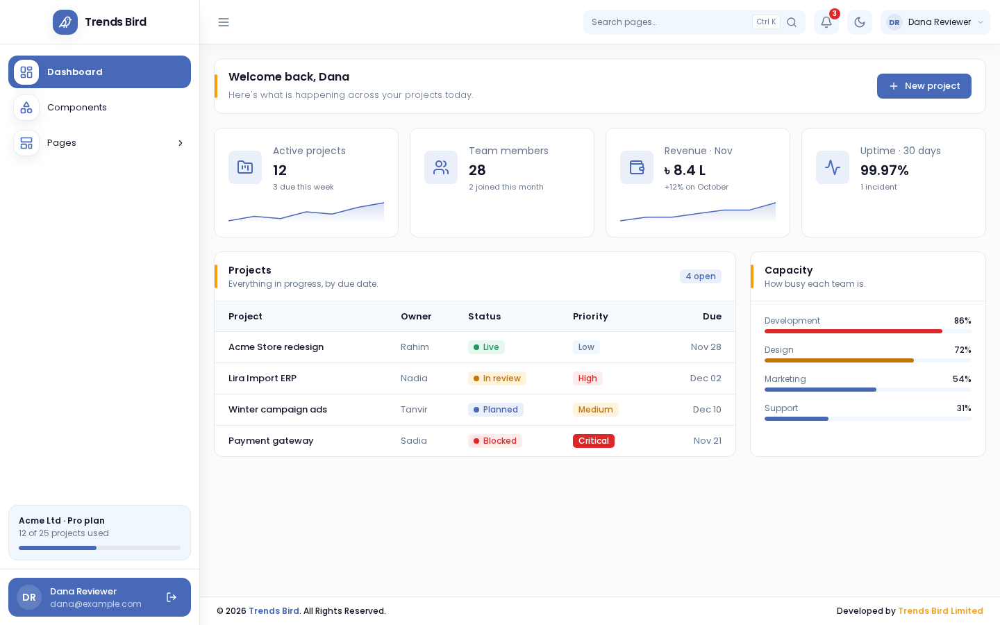
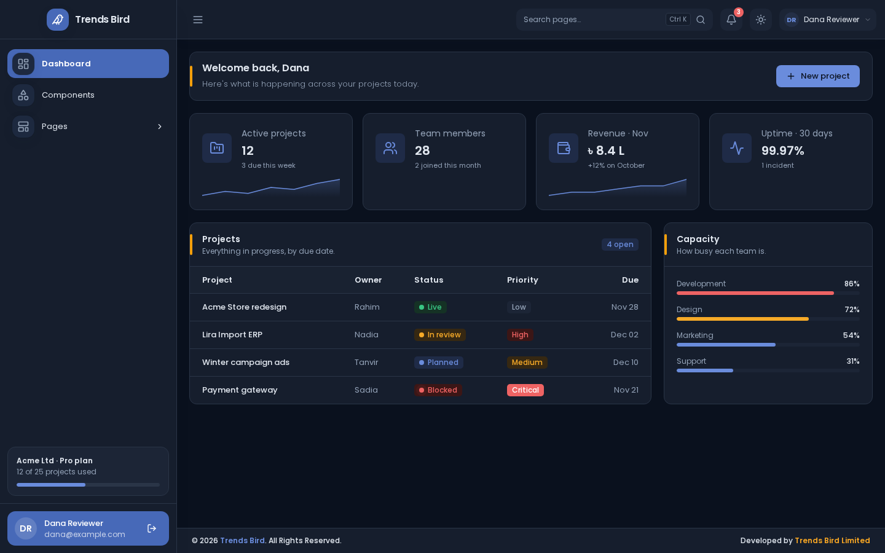
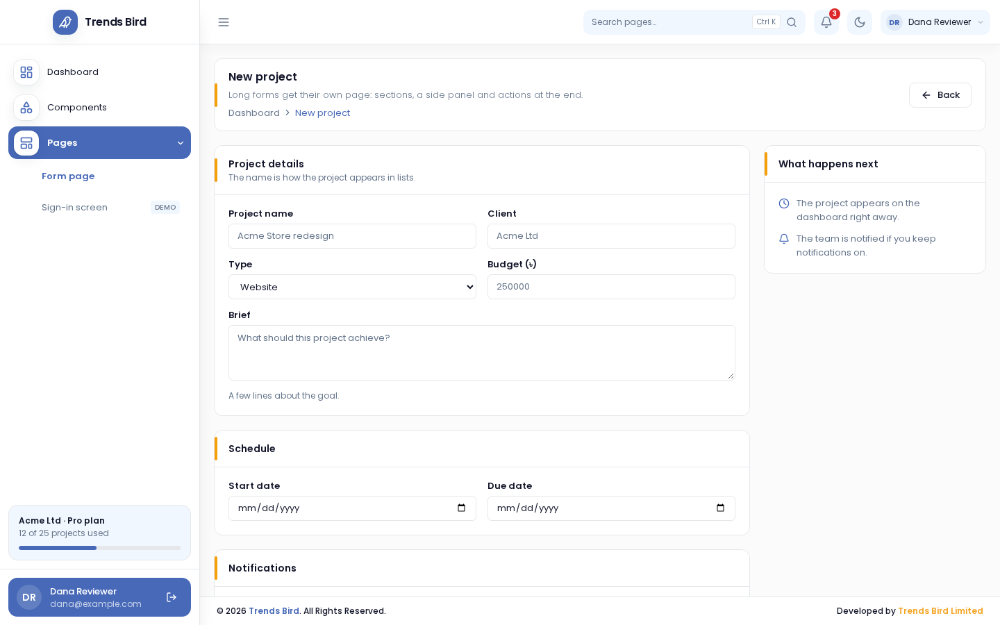

# Trends Bird UI

The Trends Bird design language (the look of the Trends ERP portal and SecurityPro) as ready-to-use **Next.js + Tailwind CSS** components:
- the sidebar layout, with collapsible folders, an icon-only rail and a mobile drawer;
- a top bar with quick search (Ctrl/⌘ K), a theme toggle and an account menu;
- page headers, cards, buttons, badges and fields;
- dialogs, tabs, tables with bulk actions;
- long-form pages and a two-panel sign-in screen;
- light and dark mode.



| Dark mode | Form page |
|---|---|
|  |  |

This repo is both a **starter** (clone it and build your app in it) and a **kit** (copy the folders into an existing project).

## Quick start

```bash
git clone https://github.com/ChadmiSaum/trendsbird-ui.git my-app
cd my-app
npm install
npm run dev        # http://localhost:3000
```

The demo pages show everything:

| Page | Shows |
|---|---|
| `/` | Dashboard: page header, stat cards with sparklines, a table with status and priority badges, meters |
| `/components` | Every component: buttons, badges, fields, switches, dialogs, notices, bulk-select table, tabs, empty state |
| `/forms` | A long form as a page: sections, side panel, action bar |
| `/login` | Two-panel sign-in screen |

`npm run build`, `npm run lint` and `npm run typecheck` all pass.

## Use it in an existing Next.js project

1. Copy these into your project, keeping the paths, since the code imports `@/…` as `src/…`:
   - `src/components/ui/`: the components;
   - `src/components/layout/`: the app shell, sidebar, top bar, page header, footer and sign-in shell;
   - `src/lib/utils.ts`: the `cn()` and `initials()` helpers;
   - `src/app/globals.css`: the colour tokens, dark mode, table and print rules;
   - `tailwind.config.ts`: maps the tokens to Tailwind classes such as `bg-card`, `text-primary` and `bg-brand`.
2. Install the dependencies:
   ```bash
   npm install class-variance-authority clsx tailwind-merge lucide-react next-themes
   npm install -D tailwindcss@3 postcss autoprefixer
   ```
3. In your root layout, load the font and the theme provider as in [`src/app/layout.tsx`](src/app/layout.tsx): Poppins into `--font-sans`, plus `ThemeProvider attribute="class"`.
4. Make sure `tsconfig.json` has `"paths": { "@/*": ["./src/*"] }`.

Requirements: Next.js 15 or 16, React 19, Tailwind CSS 3.4.

## The app shell

Describe your menu once in [`src/config/navigation.ts`](src/config/navigation.ts):

```ts
export const brand: Brand = { name: "Acme", icon: Building2 };   // or logo: 

export const nav: NavItem[] = [
  { href: "/", label: "Dashboard", icon: LayoutDashboard },
  { label: "Sales", icon: ShoppingCart, children: [
      { href: "/orders", label: "Orders" },
      { href: "/invoices", label: "Invoices", tag: "New" },
  ] },
];
```

Then wrap your signed-in pages, as in [`src/app/(app)/demo-shell.tsx`](src/app/(app)/demo-shell.tsx):

```tsx
<AppShell
  brand={brand}
  nav={nav}
  user={{ name: "Dana Reviewer", email: "dana@example.com", subtitle: "Admin · Acme" }}
  onSignOut={logout}
  userMenu={[{ label: "Profile", icon: User, href: "/profile" }, { label: "Sign out", icon: LogOut, onClick: logout, danger: true }]}
  topbarActions={<NotificationBell />}   // style your buttons with topbarIconButton
  sidebarExtra={<PlanCard />}            // optional card above the account card
>
  {children}
</AppShell>
```

The menu holds icon components, so set the shell up in a client component (`"use client"`) and use it from your layout. Other props:
- `topbarStart`: content left of the top bar's controls;
- `banner`: content above every page;
- `footer`: replace the footer, or pass `null` for none;
- `storageKey`: where the collapsed-sidebar setting is remembered.

## Components

| File | Exports |
|---|---|
| `ui/button.tsx` | `Button` (variants `primary`, `secondary`, `ghost` and `danger`; sizes `sm`, `md`, `lg` and `icon`) and `buttonVariants`, for links that look like buttons |
| `ui/card.tsx` | `Card`, `CardHeader` (title with the amber marker), `CardContent` |
| `ui/badge.tsx` | `Badge` (tones `neutral`, `primary`, `success`, `warning` and `danger`) |
| `ui/status.tsx` | `StatusBadge`, `StatusDot`, `SeverityBadge` |
| `ui/input.tsx`, `ui/field.tsx` | `Input` (with an optional icon), `Field` (label, hint and error), `Select`, `Textarea` |
| `ui/switch.tsx` | `Switch` |
| `ui/tabs.tsx` | `Tabs` |
| `ui/dialog.tsx`, `ui/confirm-dialog.tsx` | `Dialog`, which renders into `<body>` so it is never clipped, and `ConfirmDialog` |
| `ui/form-layout.tsx` | `FormSection`, `FieldGrid`, `FormFooter`, `Breadcrumb` |
| `ui/bulk.tsx` | `useSelection`, `Checkbox` (with an indeterminate state), `BulkBar`, `runBulk` |
| `ui/stat-card.tsx`, `ui/sparkline.tsx`, `ui/meter.tsx` | `StatCard`, `Sparkline`, `Meter` |
| `ui/empty-state.tsx`, `ui/notice.tsx` | `EmptyState`, `Notice` |
| `layout/page-header.tsx` | `PageHeader` (title, description and actions on the right) |
| `layout/auth-shell.tsx` | `AuthShell` (two-panel sign-in card) |

## Conventions

- **Dialog or page.** A form with a few fields (about five, fitting on one screen) goes in a `Dialog`. A longer form gets its own page built from `FormSection`s and a `FormFooter`, like `/forms`.
- **Status always has a label.** Never show a status by colour alone; `StatusBadge` takes a `label`.
- **The page's main action** goes on the right of the `PageHeader`.
- **Scrolling.** The content area scrolls, not the window. Its id is `content`, so call `document.getElementById("content")?.scrollTo({ top: 0 })` to go back to the top. Sticky elements inside a page use `top-0`.

## Theming

All colours are CSS variables in `src/app/globals.css`, set for light (`:root`) and dark (`.dark`). They are space-separated HSL, so Tailwind opacity works (`bg-primary/20`). To rebrand, change `--primary` (buttons, links, focus) and `--brand` (the active sidebar item, account card and sign-in panel). `--accent` is the header marker and `--brand-orange` the footer link.

| Token | Light | Used for |
|---|---|---|
| `--primary` / `--brand` | `222 44% 50%` (#486AB8) | actions, active menu item |
| `--foreground` | `232 38% 12%` (#13162A) | text |
| `--muted` | `213 85% 97%` | tinted surfaces, hover |
| `--accent` | `38 92% 50%` | amber section marker |

Font: Poppins (from `next/font/google`), with a 13px body.
